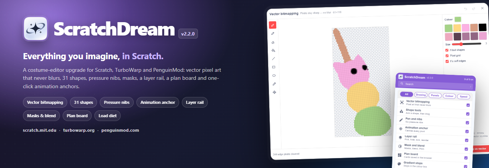
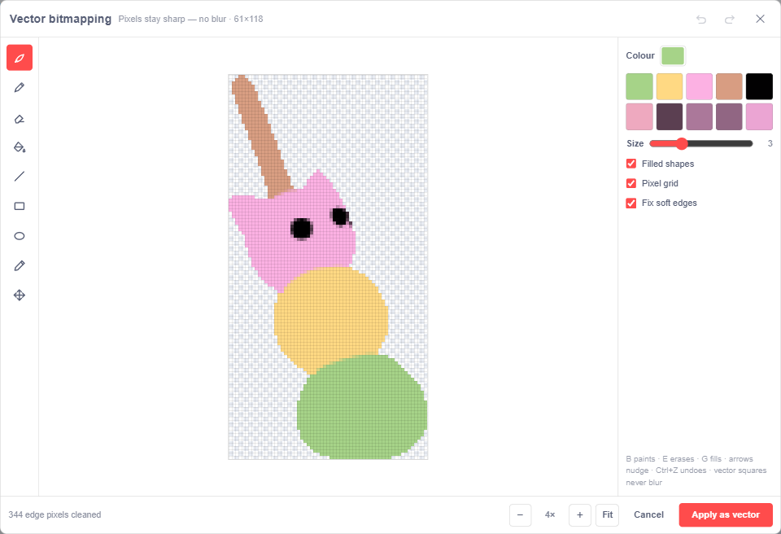
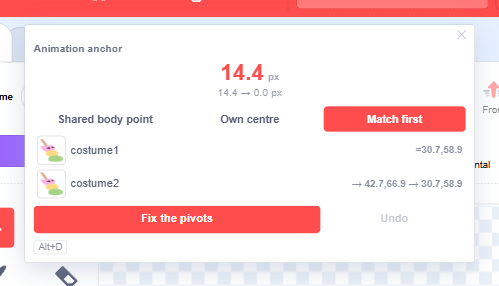
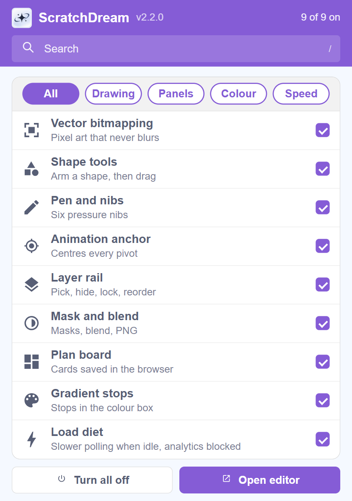
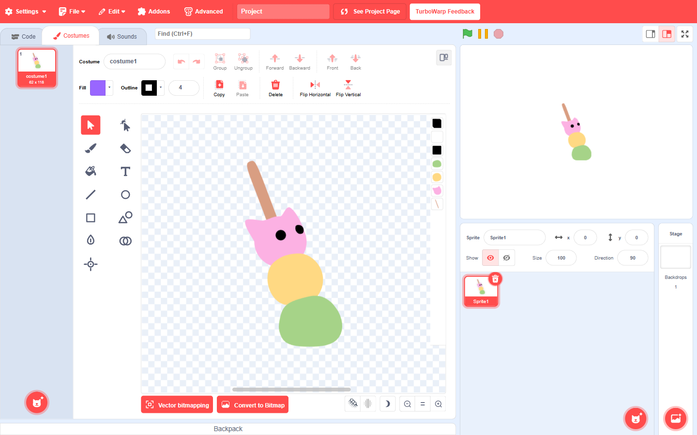
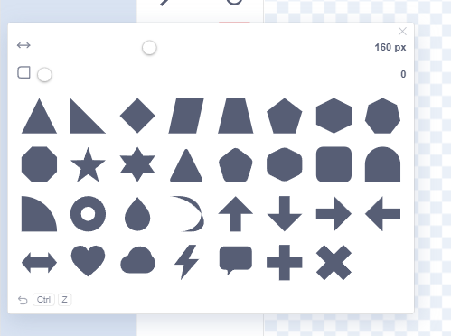
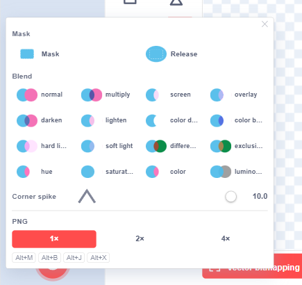
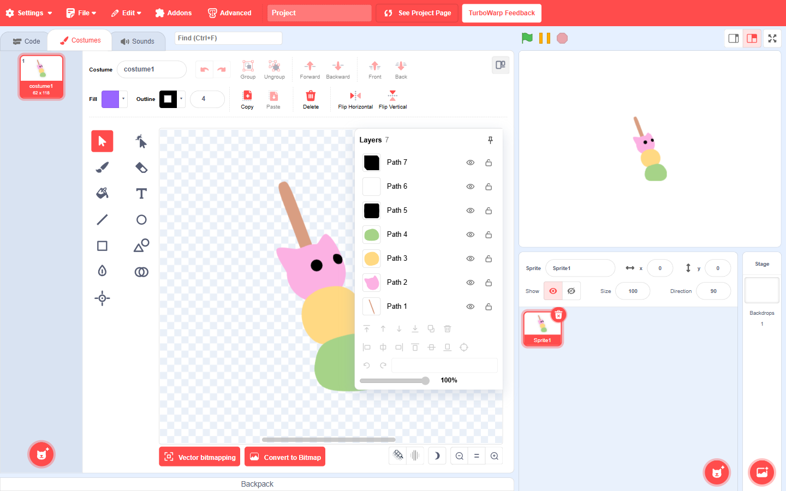
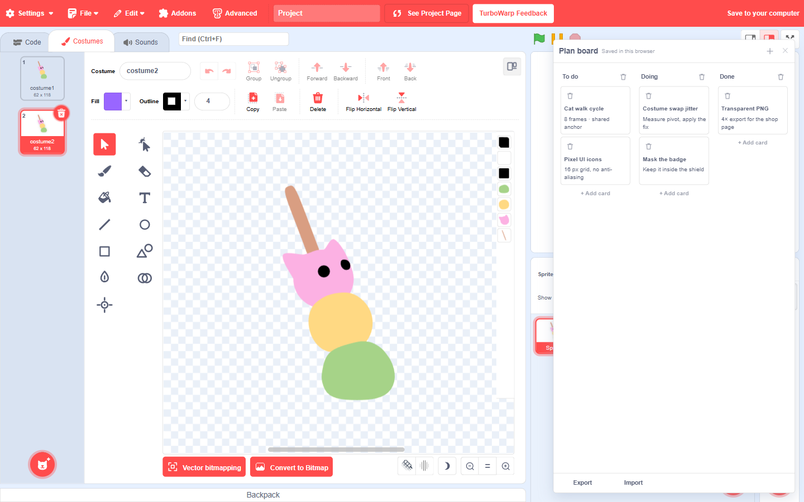
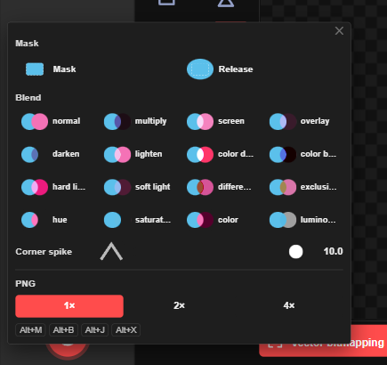

<div align="center">
  
</div>

<h1 align="center">ScratchDream</h1>

<p align="center">
  <b>Everything you imagine, in Scratch.</b><br>
  A Chrome extension that upgrades the costume editor in <b>Scratch</b>, <b>TurboWarp</b> and <b>PenguinMod</b>.
</p>

<p align="center">
  <a href="#install"></a>
  
  
  
  
</p>

<p align="center">
  <a href="#install">Install</a> ·
  <a href="#features">Features</a> ·
  <a href="#screenshots">Screenshots</a> ·
  <a href="#shortcuts">Shortcuts</a> ·
  <a href="#privacy">Privacy</a> ·
  <a href="#development">Development</a>
</p>

---

**ScratchDream** adds a professional drawing workflow to the Scratch costume editor without replacing it. The tools live inside the editor you already know: the same canvas, the same panels, the same undo stack, the same project file.

It is built for the people who draw costumes every day — pixel artists, animators, and anyone who has ever nudged a pivot point frame by frame.

<div align="center">
  
  <br>
  <sub><b>Vector bitmapping</b> — a separate pixel editor that writes real vector paths. No blur, no half-pixel residue.</sub>
</div>

## Why ScratchDream?

- **Pixel art that stays sharp.** The pixel editor writes vector paths, so a sprite can be scaled on stage without turning into a blurry bitmap.
- **The tools Scratch forgot.** 31 shapes, pressure nibs, masks, blend modes, a layer rail and transparent PNG export — all inside the costume tab.
- **Animation anchors in one click.** Measure how far the drawing jumps between costumes and write a shared pivot for all of them.
- **A plan board that stays out of the way.** Keep the art task list in the costume editor instead of another tab.
- **No account. No server. No telemetry.** Two permissions, no host access, no network calls.

## Install

### Requirements

- **Chrome**, **Edge**, **Brave**, **Opera**, or another Chromium browser that supports Manifest V3 extensions.
- A Scratch, TurboWarp or PenguinMod editor tab.

> Firefox is not supported: the extension relies on Chrome's `world: "MAIN"` content scripts and `declarativeNetRequest` rules.

### Step by step

1. **Download the repository.**
   - On GitHub: **Code → Download ZIP**, then extract it.
   - Or clone it:
     ```bash
     git clone https://github.com/Syron01/ScratchDream.git
     ```

2. **Open the extensions page.**
   - Chrome: `chrome://extensions`
   - Edge: `edge://extensions`
   - Brave: `brave://extensions`
   - Opera: `opera://extensions`

3. **Turn on Developer mode.** The switch is in the top-right corner of the extensions page.

4. **Click “Load unpacked”.**

5. **Select the `extension` folder** — the folder that contains `manifest.json`. Do **not** select the repository root.

   ```text
   ScratchDream/
   └── extension/          ← select this folder
       ├── manifest.json
       ├── adox-kostum.js
       ├── bridge.js
       └── popup.html
   ```

6. **Pin ScratchDream** to the toolbar (puzzle-piece icon → pin), if you want quick access to the feature switches.

7. **Refresh the editor tab.** Press `F5` on `scratch.mit.edu`, `turbowarp.org` or `penguinmod.com`.

8. **Open the Costumes tab.** The four tool buttons appear in the left tool column, and **Vector bitmapping** appears next to **Convert to Bitmap** / **Convert to Vector**.

That's it. The extension is loaded from your disk; no build step and no package manager are required.

### Updating

1. Replace the files in the `extension` folder with the new version.
2. Open `chrome://extensions` and click the **reload** icon on the ScratchDream card.
3. Refresh the editor tab (`F5`).

The version label in the toolbar panel is read directly from `manifest.json`, so it always matches the loaded build.

### Uninstalling

Remove the extension from `chrome://extensions`. Plan-board notes live in the browser's `localStorage`; clear the site data for the editor if you also want to remove those.

### Troubleshooting

<details>
<summary><b>The tool buttons do not appear</b></summary>

- Refresh the editor tab after installing or reloading the extension.
- Make sure you are on the **Costumes** tab, not Code or Sounds.
- Open the ScratchDream toolbar panel and check that the relevant switch is on.
- Some features only appear for vector costumes. For example, masks and blend modes need a vector shape selection; bitmap costumes are converted first.
- If the editor was updated and the DOM changed, open an issue with the browser console output.
</details>

<details>
<summary><b>“Load unpacked” is greyed out</b></summary>

Developer mode is off. Turn it on in the top-right corner of the extensions page.
</details>

<details>
<summary><b>“Manifest file is missing or unreadable”</b></summary>

You selected the wrong folder. Select the `extension` folder itself, not the repository root and not `manifest.json`.
</details>

<details>
<summary><b>The editor feels slower after installing</b></summary>

The **Load diet** feature slows the extension's idle polling and blocks analytics requests on the supported editor domains. If you turned it off, turn it back on in the toolbar panel. The extension does not run a background worker.
</details>

## Features

### Vector bitmapping

A separate pixel-art mode that opens in its own window — it does not squeeze into the costume canvas or disturb the editor layout.

- Open it from the third button next to **Convert to Bitmap** / **Convert to Vector**, or press `Alt+P`.
- Bitmap costumes are converted to vector first; the output is always a vector costume.
- **Nine tools:** brush (filled by default), pencil, eraser, fill, line, rectangle, ellipse, colour picker, and move.
- **Size 1–8**, filled shapes, pixel grid, and automatic soft-edge cleanup.
- A 10-colour palette extracted from the current drawing, plus a full colour input.
- Undo/redo, arrow-key nudge, zoom, and **Fit**.
- **Apply as vector** writes one vector path per colour; horizontal pixel runs are merged into a single path. The result stays sharp when the sprite is scaled.
- The pixel grid is drawn at 4× and above. Edges are snapped to alpha 0 or 255, so half-transparent halos do not survive.

### Shape tools

- **31 shapes**, including triangle, star, arrow, heart, cloud, speech bubble, cross, and the usual primitives.
- Arm a shape, then drag on the canvas — the same gesture as the native rectangle tool.
- Adjust size and corner rounding from the panel.

### Pen and nibs

- **Six pressure nib profiles** plus free thickness.
- `[` / `]` to make the nib thinner or thicker; `Alt` + mouse wheel also changes thickness.
- Works with a graphics tablet's pressure data where the browser exposes it.

### Animation anchor

The flagship fix for costume swaps that make the drawing jump.

- Measures the alpha-weighted visual centre of every costume.
- Shows the **jump in pixels** between costumes.
- Three plans: **Shared body point**, **Own centre**, and **Match first**.
- **Fix the pivots** writes the rotation centre for every costume; **Undo** restores the previous values.
- Only the rotation-centre records are written. The artwork, layer order and file size do not change.
- `Alt+D` opens the panel; pressing it again applies the current plan.

<div align="center">
  
  <br>
  <sub>A real 14.4 px costume-swap jump, measured and ready to fix.</sub>
</div>

### Layer rail

A thin strip on the right edge of the canvas. Hover to open it; pin it with **Keep open**.

- Click a row to select an object; use `Shift` / `Ctrl` for multi-selection.
- **Eye** hides an object (`visibility="hidden"` is kept in the SVG), **lock** prevents selection.
- Double-click a name to rename it; the name becomes the SVG `id`.
- Four arrow buttons change z-order: front, forward, backward, back.
- Duplicate, delete, align in six directions, rotate ±90°, and set opacity.

### Masks, blend modes and transparent PNG

- **Mask / Release:** the top selected shape becomes a mask; everything below it is clipped inside it.
- **16 blend modes:** normal, multiply, screen, overlay, darken, lighten, colour dodge, colour burn, hard light, soft light, difference, exclusion, hue, saturation, colour, and luminosity.
- **Corner spike:** adjusts the miter limit on thick outlines (`Alt+J` sets 1.2).
- **Transparent PNG:** export at 1×, 2× or 4× (`Alt+X`). The export uses the tight bounds of the visible, unlocked artwork.

### Plan board

A small board button sits in the empty top-right strip of the costume header.

- Three default columns: **To do**, **Doing**, **Done**.
- Add cards, type a title and note, drag cards between columns by their top bar.
- Rename or delete columns; deleting a column moves its cards to the first column.
- Add new columns with the **+** button.
- **Export** downloads `scratchdream-board.json`; **Import** restores it.
- Notes are stored in the browser's `localStorage`, **not** in the project file. Export/import to move them to another computer.

### Gradient stops

The editor's own colour box gains 2-, 3- and 4-stop gradients, including live stop handles. The gradient is written into the costume SVG as a native `<linearGradient>`.

### Load diet

A small performance feature with a visible switch:

- Idle polling slows to 1400 ms while the editor is open and 2000 ms when it is closed.
- The loop stops completely in a background tab.
- Analytics requests from `scratch.mit.edu`, `turbowarp.org` and `penguinmod.com` to Google Tag Manager, Google Analytics and DoubleClick are blocked by a `declarativeNetRequest` ruleset.
- Turn the switch off to restore the flat 900 ms polling and disable the ruleset.

## Screenshots

<table>
<tr>
<td width="50%" valign="top">
  
  <br>
  <sub><b>The toolbar panel.</b> Nine switches, search, five categories, and an honest “9 of 9 on” count.</sub>
</td>
<td width="50%" valign="top">
  
  <br>
  <sub><b>Inside the costume editor.</b> Four extra tool buttons, the layer rail, the board button and Vector bitmapping next to the native conversion buttons.</sub>
</td>
</tr>
<tr>
<td width="50%" valign="top">
  
  <br>
  <sub><b>31 shapes.</b> Arm a shape, drag to place it, then tune size and corner rounding.</sub>
</td>
<td width="50%" valign="top">
  
  <br>
  <sub><b>Masks, 16 blend modes and PNG export.</b> Every option has a live mini sample beside its name.</sub>
</td>
</tr>
<tr>
<td width="50%" valign="top">
  
  <br>
  <sub><b>The layer rail.</b> Pick, hide, lock, rename, reorder, align, rotate and set opacity.</sub>
</td>
<td width="50%" valign="top">
  
  <br>
  <sub><b>The plan board.</b> Three columns, draggable cards, and JSON export/import. Stored in your browser, not the project.</sub>
</td>
</tr>
<tr>
<td width="50%" valign="top">
  
  <br>
  <sub><b>Vector bitmapping.</b> A full pixel editor in its own window; the output is vector, not a bitmap.</sub>
</td>
<td width="50%" valign="top">
  
  <br>
  <sub><b>Native theme support.</b> Panels borrow the editor's own colours, including dark themes and right-to-left layouts.</sub>
</td>
</tr>
</table>

## Shortcuts

| Shortcut | Action |
|---|---|
| `Alt+P` | Open / close **Vector bitmapping** |
| `Alt+D` | Open **Animation anchor**; apply the current plan when open |
| `Alt+M` | Mask / release the selected shape |
| `Alt+B` | Next blend mode |
| `Alt+Shift+B` | Previous blend mode |
| `Alt+J` | Set miter limit to 1.2 |
| `Alt+X` | Export transparent PNG |
| `[` / `]` | Thinner / thicker pen nib |
| `Alt` + mouse wheel | Pen thickness |
| `Esc` | Close the open panel, then release the armed tool |
| `Ctrl+Z` / `Ctrl+Shift+Z` | Undo / redo in the pixel editor |
| Arrow keys | Nudge the pixel drawing by one pixel |
| `+` / `-` | Zoom the pixel editor |
| `Ctrl+A` | Select all (native editor behaviour) |

Shortcuts work while the costume editor is focused. The extension never overrides a shortcut while you are typing in a text field.

## Privacy

ScratchDream is deliberately boring about data:

- **No network requests.** The extension has no background worker, no server, no account, and no AI keys.
- **No host permissions.** It only runs content scripts on `scratch.mit.edu`, `turbowarp.org`, `penguinmod.com`, and localhost.
- **Two permissions:**
  - `storage` — feature switches and the plan board's local state.
  - `declarativeNetRequest` — the optional analytics-blocking ruleset used by **Load diet**.
- **Plan board data** is stored in the editor's `localStorage`, not in the project file. Export it if you want a backup.
- **Your art stays yours.** The pixel editor writes vector paths into the costume; nothing is uploaded.

The extension's main script runs in the page's `MAIN` world because that is where Scratch's Paper.js canvas and Redux store live. A small `bridge.js` in the isolated world carries only the feature switches.

## Compatibility

| Platform | Status |
|---|---|
| [Scratch](https://scratch.mit.edu/) | Supported |
| [TurboWarp](https://turbowarp.org/) | Supported |
| [PenguinMod](https://penguinmod.com/) | Supported |
| Chrome / Edge / Brave / Opera (Manifest V3) | Supported |
| Firefox | Not supported |

The extension is tested against live editors. The repository includes the same harness used for those runs: `dev/verify.mjs` (end-to-end, 47 checks) and `dev/diet.mjs` (load-diet measurements).

## Development

```bash
git clone https://github.com/Syron01/ScratchDream.git
cd ScratchDream/dev
npm install
```

The live harness needs Google Chrome and a network connection to load the real TurboWarp editor. On Windows the Chrome path is `C:/Program Files/Google/Chrome/Application/chrome.exe`; edit `CHROME` in `dev/harness.mjs` if yours is elsewhere.

```bash
node verify.mjs    # real Chrome + unpacked extension + live TurboWarp editor
node diet.mjs      # load-diet measurements and network-request proof
node shots.mjs     # regenerate the README screenshots in docs/assets
node banner.mjs    # regenerate docs/assets/banner.png
```

### Project structure

```text
extension/                 Chrome MV3 extension — load this folder
├── manifest.json          version, permissions, content-script matches
├── adox-kostum.js         all product code (MAIN world)
├── bridge.js              feature-switch bridge (ISOLATED world)
├── popup.html/css/js      toolbar panel: search, categories, nine switches
├── icons/                 logo and toolbar icons
└── rules/diet.json        declarativeNetRequest analytics blocklist

dev/                       live test harness, screenshot and banner tools
docs/                      README assets, banner source, landing page
Kurulum.md                 Turkish installation and user guide
```

### Design notes

- The extension is a single content script in the page's `MAIN` world. It reads the editor's own Paper.js scope and Redux store, so it works on Scratch, TurboWarp and PenguinMod without separate builds.
- Panels are styled from CSS variables sampled from the editor's own theme, not from a brand theme. They follow dark mode and right-to-left layouts.
- The pixel editor never creates a bitmap costume. It rasterises the current vector costume into a pixel grid, lets you edit it, then writes one compound path per colour back into the SVG.
- The animation anchor writes only `rotationCenterX` / `rotationCenterY`; it does not touch paths, layers or asset IDs.

## Version history

| Version | Highlights |
|---|---|
| **2.2.0** | Load diet, nib-box placement fix, Turkish/Arabic UI support |
| **2.1.0** | Separate vector pixel editor; toolbar panel reduced to 420 px |
| **2.0.0** | Pixel mode, plan board, new logo; Magic Code removed |
| **1.8.0** | Animation anchor |
| **1.7.0** | Layer rail, compact mask/blend panel, ScratchDream branding |
| **1.5.x** | Layers, alignment, rotation, opacity, multi-selection |

## License

MIT — see [LICENSE](LICENSE).

ScratchDream is an independent project. Scratch is a project of the Scratch Foundation; TurboWarp and PenguinMod are separate community projects. This extension is not affiliated with or endorsed by any of them.

<div align="center">
  <sub>Made for people who draw costumes, not just blocks.</sub>
</div>
